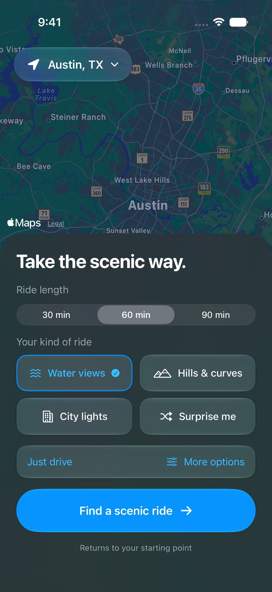
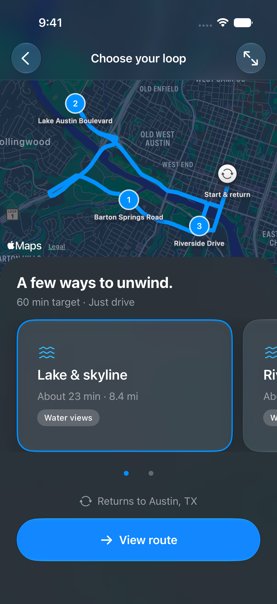
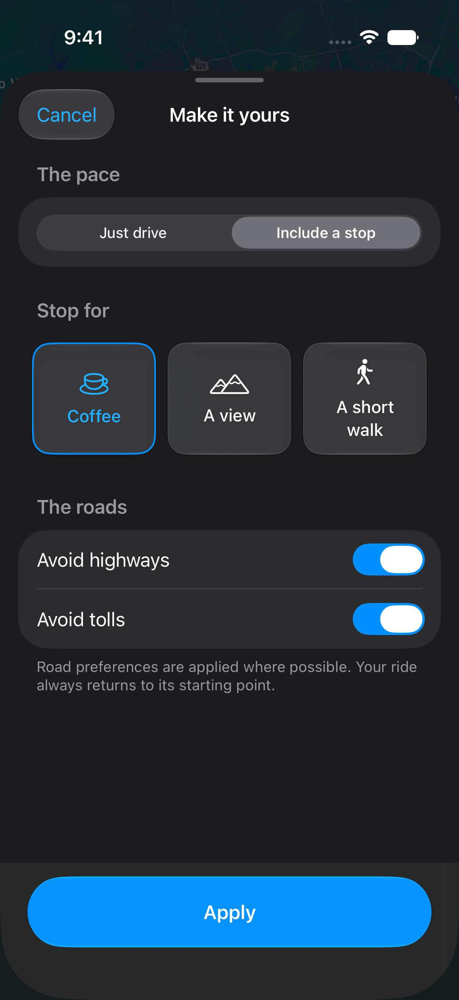

# Scenic Rides

A native iPhone app for choosing and previewing a scenic Austin round trip. Built with SwiftUI, MapKit, Core Location, and SF Symbols. Minimum deployment target: **iOS 26.0**. No third-party packages or map API keys are required.

<p>
  
  
  
</p>

## Open and run

1. Open `ScenicRides.xcodeproj` in Xcode 26 or later.
2. Select the **ScenicRides** scheme and an iPhone simulator running iOS 26 or later.
3. Run. For a physical device, choose your development team in Signing & Capabilities and change the bundle identifier if needed.

The project includes a shared scheme and has no package-resolution step. Build products are intentionally excluded.

## Choose a ride

The home screen combines a live dark Apple map, a starting-point button, a 30/60/90-minute duration target, and four ride styles:

| Style | Route choices |
| --- | --- |
| Water views | Lake & skyline; Riverside loop |
| Hills & curves | Hills & river; Westlake wander |
| City lights | City & skyline; East Austin loop |
| Surprise me | One choice from each of the three styles, shuffled once per preview |

All rides return to the selected starting point. City lights selects urban scenery; it does not schedule a night ride. Starting-point search and **Use my location** remain available. Location permission is requested only after choosing that action; denial leaves manual search available. Austin is a generic city-level default, not a claim about the device's location.

**More options** opens a native sheet:

- **Just drive** uses public roads and intersections to shape a drive without scheduling a stop.
- **Include a stop** adds one public destination: Coffee at Mozart’s Coffee Roasters, A view at Mount Bonnell, or A short walk at Butler Park.
- **Avoid highways** and **Avoid tolls** are passed to every MapKit driving request, including the return leg. Defaults are highways allowed and tolls avoided. These are routing preferences, applied where possible.
- **Apply** saves the draft choices for this session. Cancel or dismissing the sheet discards unapplied edits. Apply stays above the safe area when the form scrolls.

Native Liquid Glass styles are used for choice cards and buttons. Content panels use native material, with system typography and dark appearance. Large text switches the choice grids to one column and makes the map panels scroll. Selected choices have accessibility traits, and camera/selection animation respects Reduce Motion.

## Compare Austin loops

**Find a scenic ride** opens a full-screen MapKit preview. Swipe the cards, tap a card, or use the page indicators to select an alternative. The selected card, road polyline, numbered waypoints, and **View route** itinerary stay in sync. The map toolbar fits the whole route after panning.

MapKit resolves public roads, intersections, and destinations and calculates every driving leg, including the return to the selected starting coordinate. Cards show the sum of actual distance and driving-time estimates. Alternatives load sequentially and successful routes stay cached while viewing this preview. A failed choice can be retried without losing successful alternatives. Cancelling or leaving the preview prevents late results from replacing the current state.

The itinerary distinguishes **Drive through** waypoints from the optional stop and lists both Start and Return. Stop time is extra. Opening hours, parking, and access are not verified by the app; Mount Bonnell’s overlook requires walking.

The duration picker remains a **target**, not a promised length or an optimized time budget. The catalog contains two fixed loops per style: 30 and 60 minutes use the same initial order, while 90 minutes reverses it. Actual routes can be shorter or longer than the target. MapKit chooses connecting roads, which may retrace portions of the drive. This is not a scenic-road or duration optimizer.

Starting points are supported within 40 km of central Austin. An unsupported start gets a clear message and a way back. No partial route is presented as a complete round trip if any leg fails.

## Data and scope

Preferences and routes stay in memory. Map display, place searches, and directions use Apple's MapKit services; there is no application backend or analytics integration. Screenshots use the generic Austin starting point and public destinations. Personal addresses, location histories, credentials, signing files, and local build/test artifacts stay out of this repository.

`HomeScreen(onFindRide:)` passes a typed `RideRequest` with the start, duration, style, and options. `ScenicRidesApp` presents `RoutePreviewScreen`, which obtains complete routes through `MapKitRoutePlanner`.

Vehicle connectivity, booking, fares, in-ride guidance, and automatic duration optimization are **not implemented**. Viewing a route does not start navigation or book a vehicle.

## Structure

- `HomeScreen.swift`: map and ride controls.
- `RidePreferences.swift`: request, style, duration, stop, and road-preference types.
- `RideOptionsSheet.swift`: draft options, Apply/Cancel, and shared glass choice buttons.
- `StartingPlacePicker.swift` and `LocationService.swift`: native search and foreground location requests.
- `AustinRoutes.swift`: six public route definitions and optional stop destinations.
- `RoutePlanner.swift`: MapKit resolution/directions, cancellation, and per-choice preview state.
- `RoutePreviewScreen.swift`: route carousel, synchronized map, loading/retry states, and itinerary.
- `ScenicRidesTests`: round-trip integrity, preferences, alternatives, and cancellation coverage.
- `ScenicRidesUITests`: home, options, swiping, accessibility text sizes, and live Apple service checks.

## Validation

Run **Product → Test** or:

```sh
xcodebuild -project ScenicRides.xcodeproj -scheme ScenicRides \
  -destination 'platform=iOS Simulator,name=YOUR_SIMULATOR' test
```

If the developer directory points to Command Line Tools, select the installed Xcode in Settings → Locations or set `DEVELOPER_DIR` for the command. This project does not change the machine's selected Xcode.

Build and simulator results are recorded in [VALIDATION.md](VALIDATION.md). The live place-search test and `RoutePreviewTests/testLiveStyleChoicesAndCoffeeStop` require connectivity to Apple. Other preview UI tests use a debug-only injected planner for deterministic loading, success, and failure/retry states. Release builds exclude that planner. The published route screenshot comes from live MapKit directions. Test logs and raw result bundles remain local.

## References

- [MapKit for SwiftUI](https://developer.apple.com/documentation/mapkit/mapkit-for-swiftui) and [directions](https://developer.apple.com/documentation/mapkit/mkdirections)
- [MapKit highway preferences](https://developer.apple.com/documentation/mapkit/mkdirections/request/highwaypreference) and [toll preferences](https://developer.apple.com/documentation/mapkit/mkdirections/request/tollpreference)
- [Native view-aligned scrolling](https://developer.apple.com/documentation/swiftui/scrolltargetbehavior/viewaligned)
- [Liquid Glass materials](https://developer.apple.com/design/human-interface-guidelines/materials) and [prominent glass buttons](https://developer.apple.com/documentation/swiftui/glassprominentbuttonstyle)
- [Location authorization](https://developer.apple.com/documentation/corelocation/requesting-authorization-to-use-location-services)
- [City of Austin park directory](https://www.austintexas.gov/parks/locations/park-directory), [Mozart’s FAQ](https://mozartscoffee.com/pages/frequently-asked-questions), and [Mount Bonnell guide](https://www.austintexas.org/austin-insider-blog/blog/post/mount-bonnell-for-beginners/)

MapKit resolves the public map locations at runtime. Place access and service estimates can change.
